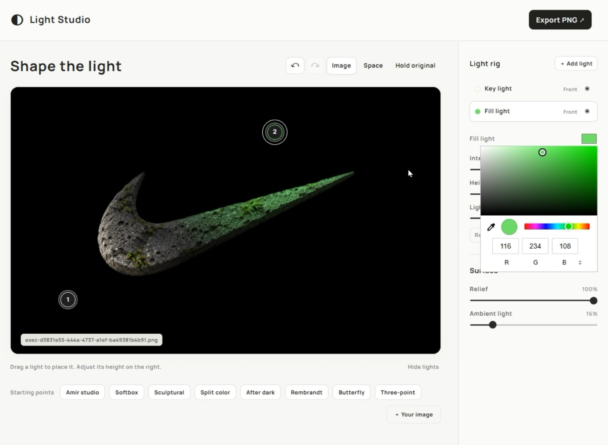
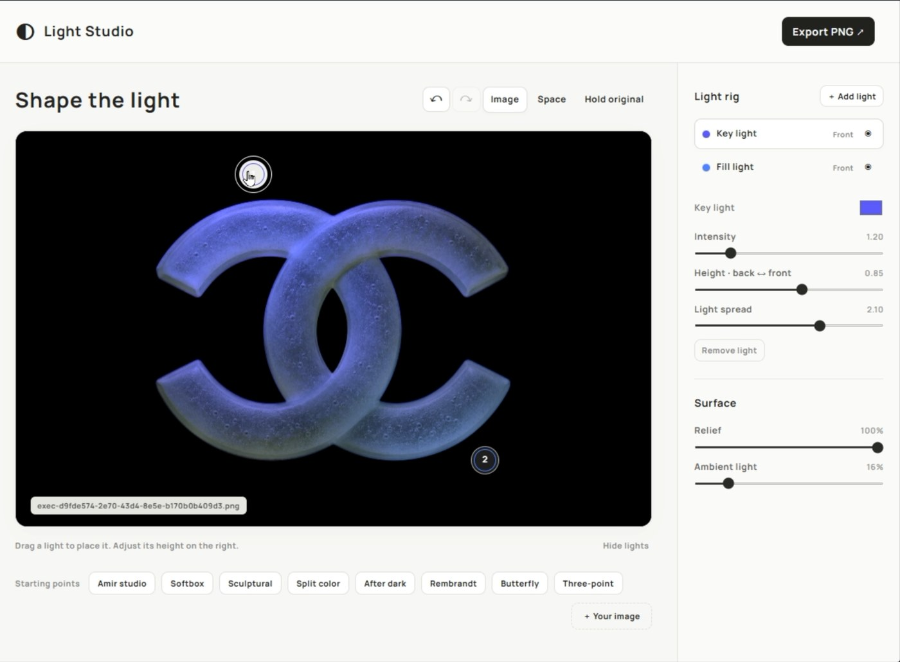
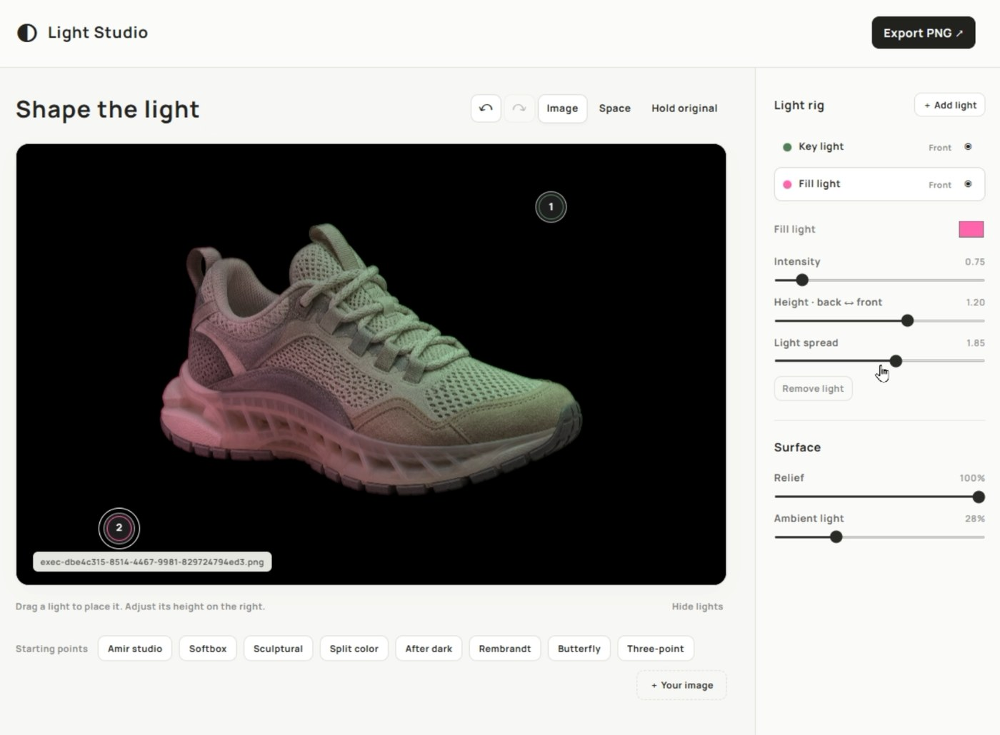

# Light Studio 1.0

Interactive lighting editor for photos. Upload an image, place up to six lights, tweak their color, intensity, height and spread, and download the result as a PNG at the original resolution, including a verified 8K export.

- Light is controlled right on the photo: a few mouse moves instead of long settings and prompts.
- Up to six independent lights, ready-made lighting setups (Amir studio, Softbox, Sculptural, Split color, After dark, Rembrandt, Butterfly, Three-point), comparison with the original, Undo / Redo.
- Photos stay on your device. Depth is estimated locally by a free model, and lighting is computed in the browser.
- No prompts, no API keys, no account or subscription.

## Screenshots

**Green light on a textured object**

**Blue key and fill lights**

**Two-color light on a product shot**

The interface is in English. No images, logos or examples are included in the package; it opens with an empty canvas. The Starting Point **Amir studio** is saved, and Relief is 100% by default.

## Quick start

### Windows

1. Fully extract the ZIP into a regular folder you have write access to. Do not run it from inside the archive window.
2. Double-click **START.cmd**.
3. On the first run, wait for the automatic setup. If Node.js 22+ is not installed, the launcher downloads a portable Node.js 24 LTS from nodejs.org into its own `.runtime` folder, with no system-wide install. It then downloads pinned versions of the library and the depth model (about 50 MB). SHA-256 checksums are verified.
4. The browser opens automatically. If it does not, open the address shown in the launcher window. Keep the launcher window open.

The first run needs internet access to nodejs.org, cdn.jsdelivr.net and huggingface.co. After setup, all required files are stored locally and later runs work offline. No API keys, account or paid services are needed. If a download is interrupted, run START again: valid files are kept, damaged ones are downloaded again. Do not disable TLS verification if your network blocks downloads; use another network.

To stop, press Ctrl+C in the launcher window. Do not move the folder while the app is running. The app and the model are not updated automatically; versions are pinned in `dependencies.json`.

### macOS / Linux

Open Terminal in the app folder and run `sh START.command`. It uses an installed Node.js 22+ or automatically downloads portable Node.js 24 LTS for x64/ARM64. Standard `curl`, `tar` and `sha256sum` (or `shasum`) are required. On macOS you can also make the file executable: `chmod +x START.command`.

If Node.js is already installed, you can run `node launch.mjs --open`. A separate `npm install` is not needed. To run the built-in tests: `node --test lighting-math.test.js export-image.test.js`.

## Using the app

1. Click **Upload an image / Your image** or drag a PNG, JPG or WebP onto the canvas.
2. Wait for the local depth estimation. While it is not ready, or if it fails, the original photo is shown. On failure, use **Retry depth estimation**.
3. Move the light points. Adjust color, Intensity, Height, Light spread, Relief and Ambient light. Up to six lights. **Amir studio** restores the saved setup; editing never changes the original preset.
4. **Hold original** shows the source image while held. **Space** shows the light placement view, not a full 3D reconstruction.
5. Undo / Redo: arrows at the top, Ctrl+Z, Ctrl+Shift+Z, Ctrl+Y. On macOS also Cmd+Z / Cmd+Shift+Z. History keeps up to 60 states in the current session and is not saved between page reloads.
6. **Export PNG** downloads the result without the control points at the exact original size. For example, a 7680 × 4320 upload gives a 7680 × 4320 PNG. The preview size does not limit the export. The file goes to your browser's default downloads folder.

Your photos are not sent to a server or a cloud AI: decoding, depth and lighting are computed in the browser. The server only serves local files and listens on 127.0.0.1, with no access from the local network. The model download on first launch does not include your photos. The project does not save user photos to disk; export happens only when you click the button.

## Requirements and limits

A modern desktop Chrome or Edge with WebGL 2 and enough memory. 16 GB of RAM is recommended for 8K. If the device does not support the source texture size or cannot allocate the memory, the app reports an error; there is no silent downscaling. Arbitrary resolution cannot be guaranteed on every device.

This is approximate relighting based on an estimated depth map. A single photo does not recover hidden surfaces and does not fully remove the original shadows and highlights. Back lights are separated from the subject for images with a black background; there is no full automatic subject cutout for complex backgrounds. Colored backgrounds and other objects may be lit together with the scene.

The PNG is encoded losslessly and keeps the original pixel count, but the current output is 8-bit RGB without RAW/HDR data, alpha channel, the original ICC profile, EXIF or other metadata. The depth map and the mask are computed at a lower resolution than the source photo. This is not generation of new detail or 8K upscaling. Video and saving a project between sessions are not implemented.

## What is included

Application source, English UI, the Amir studio preset and other Starting Points, automatic environment and dependency downloaders, a local server, the Manrope font with its license, dependency notes and tests. The package contains no photos, logos, screenshots, keys, personal paths, chat history, `node_modules` or third-party demo images.

## Third-party components and licenses

See **THIRD-PARTY-NOTICES.md**, the **licenses** folder and **assets/OFL-Manrope.txt**. In short:

- Lighting techniques adapted from Codrops / Dominik Fojcik, [codrops-relightning-images](https://github.com/DGFX/codrops-relightning-images) (MIT declared in its README). Its source and artwork are not included.
- Transformers.js (Apache-2.0), Hugging Face Jinja (MIT), ONNX Runtime Web (MIT).
- Depth Anything V2 Small ONNX (Apache-2.0), downloaded on first launch.
- Manrope font (SIL OFL 1.1).
- Node.js 24 LTS is downloaded only when needed and is not bundled.
